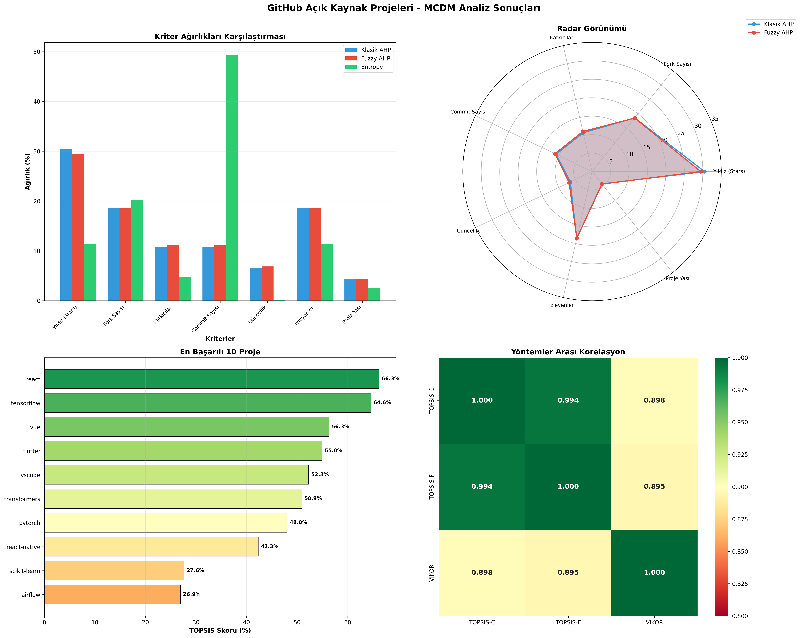

# GitHub Açık Kaynak Başarı Analizi (eski sürüm)

> **Eski sürüm.** Bu depo projenin ilk hâlidir ve artık güncellenmiyor.
> Güncel sürüm: **[github-acik-kaynak-basari-analizi](https://github.com/furkandennizz/github-acik-kaynak-basari-analizi)**

Miuul bitirme projesi. 129 açık kaynak GitHub projesi 7 kriterle değerlendirilip çok kriterli karar verme (MCDM) yöntemleriyle sıralanıyor. Sonuçlar bir Flask panelinde gösteriliyor.



## Yöntem

- **Kriter ağırlıkları:** Klasik AHP, Fuzzy AHP (Buckley), Entropy
- **Sıralama:** TOPSIS ve VIKOR
- **Kontroller:** AHP tutarlılık oranı, yöntemler arası Kendall τ, duyarlılık analizi, normallik ve aykırı değer testleri
- **ML:** TOPSIS skorunu ham metriklerden tahmin eden modeller (Ridge, Random Forest, Gradient Boosting, XGBoost)

**Kriterler:** yıldız, fork, katkıcı, commit, güncellik (son güncellemeden bu yana geçen gün, maliyet kriteri), izleyen, proje yaşı.

## Dosyalar

| Dosya | İçerik |
|---|---|
| `github_collector.py` | GitHub REST API'den veriyi MySQL'e yazar |
| `repo_finder.py` | Kategoriye ve seviyeye göre proje arar |
| `analysis_pro.py` | AHP, Fuzzy AHP, Entropy, TOPSIS, VIKOR ve istatistiksel kontroller |
| `ml_model.py` | TOPSIS skorunu tahmin eden ML modelleri |
| `visualization.py` | Grafikler |
| `app.py`, `templates/`, `static/` | Flask paneli |
| `repos_list.txt` | Projeler ve kategorileri |
| `veri/miuuldata.csv` | Projelerin ham metrikleri (MySQL `repositories` tablosundan dışa aktarım) |
| `veri/VERI_SETI.md` | Veri setinin açıklaması |

`veri/miuuldata.csv` yalnızca `repositories` tablosunu içerir. Analizin kullandığı katkıcı ve commit tabloları bu depoda yok, bu yüzden bu sürüm yalnızca kendi MySQL veritabanıyla çalışır.

## Çalıştırma

MySQL 8 üzerinde `github_analysis` veritabanı ve bir GitHub kişisel erişim token'ı gerekir.

```bash
pip install -r requirements.txt
export GITHUB_TOKEN=...          # token ve şifreyi koda yazmayın
export MYSQL_PASSWORD=...
python github_collector.py        # veriyi toplar
python analysis_pro.py            # MCDM analizi
python visualization.py           # grafikler
python app.py                     # panel: http://localhost:5000
```
